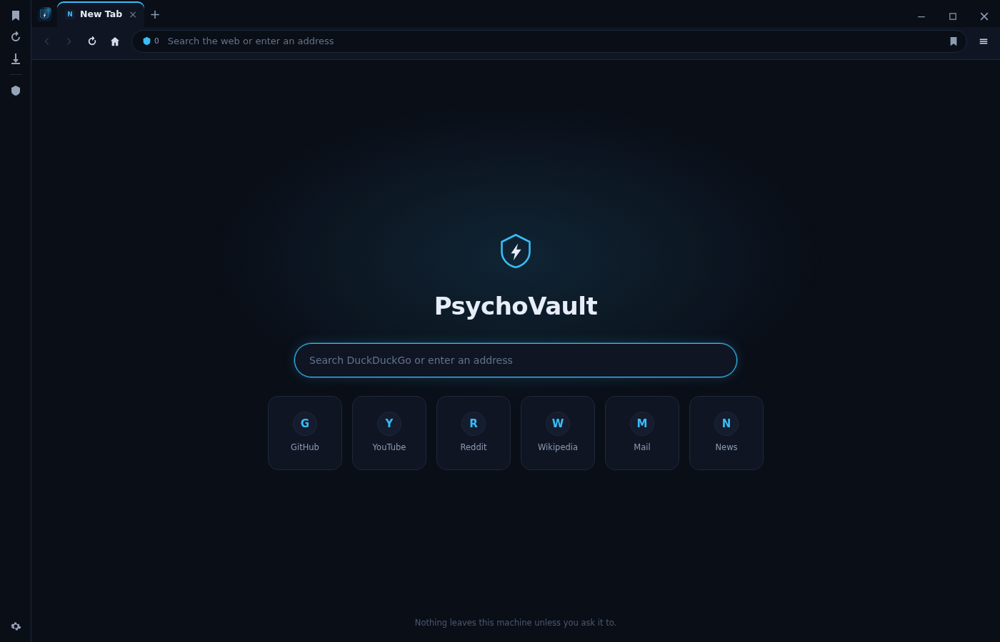
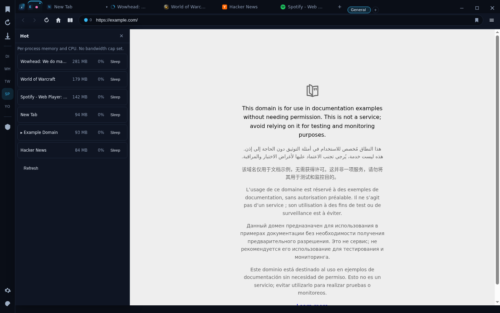

# PsychoVault

I'm Psycho-Core. PsychoVault is the browser I built for myself and decided to share: my own tabs, sidebar, workspaces, blocker, settings and local password vault on Chromium. Windows x64 is the main release; Android is experimental.



## Download

Get the latest Windows installer from [GitHub Releases](https://github.com/Psycho-Core/PsychoVault/releases). Check `SHA256SUMS.txt` if you want to verify the download. The installer is per-user and may show a SmartScreen warning because it is not Authenticode-signed.

Packaged Windows builds check for updates and ask before installing. Updates verify a signed manifest and the installer checksum.

## What I built

- Tabs, split view, private windows and saved workspaces.
- Bookmarks, history, downloads and configurable sidebar shortcuts.
- Built-in domain blocking with exceptions and per-page counts.
- Local encrypted password vault with master password or OS keychain, import and encrypted backup.
- Performance panel with tab sleep/wake, CPU priority, resource stats and a download bandwidth cap.
- Find, zoom, page capture, themes, accessibility options and extension management.
- Dark Reader and Proton VPN bundled as extensions.



## Privacy and VPN

Bookmarks, history, settings, workspaces and the vault stay in your local profile. There is no PsychoVault account or sync server. The vault never writes plaintext passwords, but an unlocked session is not protected from malware running as you.

Proton VPN needs your own Proton account. A connection indicator is not proof of protection; the VPN checks page uses third-party test services and their results are not a leak guarantee. The blocker and privacy controls are not a promise of anonymity. Only install extensions you trust.

## Run or build

You need Node.js 20 or newer to run from source:

```bash
git clone https://github.com/Psycho-Core/PsychoVault.git
cd PsychoVault/app
npm install
npm start
```

On Windows, double-click `PsychoVault_easy_build.bat` to build the installer. See [BUILD-WINDOWS.md](BUILD-WINDOWS.md) for prerequisites. Keep backups of important vault data before reinstalling or changing machines.

## Android

The Android Chromium port lives in [`android-port/`](android-port/README.md). Preview APKs are experimental and may not match the current source. Extension behaviour, Proton routing and leak protection still need device verification. Back up anything important before uninstalling an older preview; a different signing key can require a separate install.

## Licence and warranty

My application code is [MIT](LICENSE), copyright 2026 Psycho-Core. Bundled software keeps its own licences; see [THIRD-PARTY-NOTICES.md](THIRD-PARTY-NOTICES.md). PsychoVault is provided as-is, without warranties or guarantees.
