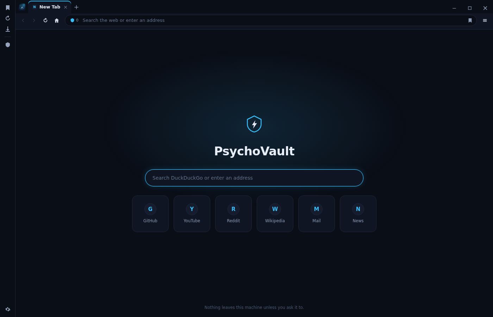

# PsychoVault

I'm Psycho-Core. PsychoVault is the browser I built for myself and decided to share: my own tabs, address bar, sidebar, workspaces, blocker, settings and local password vault on top of Chromium. The Windows version uses Electron. The Android port is a separate, unfinished Chromium build.



This is an earlier capture of the new tab page. The current interface may look different.

## Download

Windows x64 installers are published on [GitHub Releases](https://github.com/Psycho-Core/PsychoVault/releases). Download the installer and its `SHA256SUMS.txt` from the same release if you want to check the file before running it.

The installer is per-user and does not ask for administrator rights. Windows may show a SmartScreen warning because the installer is not Authenticode-signed. Check the release checksum and make your own decision before running it.

The Android preview is experimental and does not contain the current Android source. Do not treat it as a finished browser, an extension-capable build or a working VPN build.

## What works on Windows

| Area | What you get |
| --- | --- |
| Tabs | Drag to reorder, pin, mute, duplicate, split, move to another window, reopen closed tabs, and tab islands |
| Address bar | URLs, search, history suggestions, four built-in search engines and custom HTTPS search shortcuts |
| Workspaces | Separate tab sets that survive a restart; switch, rename, close and create them from the tab row |
| Private windows | Separate in-memory session with violet chrome; private tabs are not saved to session recovery |
| Blocking | Built-in domain list with per-page counts, site exceptions and custom domains. It is not uBlock Origin and does not import filter lists |
| Passwords | Local encrypted vault with a master password or OS keychain, manual HTTPS fill, auto-lock, CSV import and encrypted backups. No sync |
| Sidebar | Bookmarks, history, downloads and configurable site shortcuts |
| Performance | Per-tab memory/CPU, tab sleep/wake, CPU priority, download bandwidth cap and battery saver |
| Downloads | Save As or automatic unique filenames, progress, pause/resume when supported, and a downloads panel |
| Page tools | Find, per-tab zoom, PNG/PDF capture, context menus and optional page translation through Google Translate |
| Appearance | Themes, accent colours, high contrast, reduced motion, keyboard sounds and a chrome-only custom stylesheet |
| Extensions | Unpacked folders and `.crx` installation, enable/disable/remove, permission and compatibility reporting. Dark Reader and Proton VPN are bundled |
| Accessibility | Visible focus, screen-reader tab names, keyboard tab navigation and optional always-visible close buttons |

Settings are grouped into General, Privacy & security, Downloads, Extensions, Performance, Appearance, Spelling, Passwords, Accessibility & language, and About.

## Proton VPN

Proton VPN is bundled as a browser extension built from Proton's GPL-3.0 source. You sign in with your own Proton account; no account, credentials or subscription are included.

On Windows, PsychoVault supplies the `chrome.proxy` and `chrome.privacy` APIs that Electron lacks, so the extension can set the browser proxy and WebRTC policy. A connection indicator alone is not proof that traffic is protected. The VPN checks page can query public IP, DNS and WebRTC test services; those services receive network information when you run them, and their results are not a guarantee against leaks.

The Android port does not yet have a verified Proton integration. I will not label it protected until installation, sign-in, proxy routing, failure behaviour and leak checks pass on a real device.

## Privacy and local data

Bookmarks, history, settings, workspaces and the vault live in your local profile. PsychoVault has no account system or sync server. Website logins still use the sites' own cookies.

The vault encrypts entries with AES-256-GCM. A master password is stretched with scrypt; where no master password is set, the OS keychain protects the key when available. If neither is usable, the vault refuses to write plaintext. No password manager can protect an unlocked session from malware running as you, a keylogger or a weak master password.

The built-in blocker, tracking-signal options, cookie controls and permission rules have limits. They are not a promise of anonymity. Page translation sends the page URL to Google only after you confirm. Extension code can read or change pages, so only install extensions you trust.

## Keyboard shortcuts

```text
Ctrl+T          new tab              Ctrl+K          command palette
Ctrl+W          close tab            Ctrl+L          address bar
Ctrl+Shift+T    reopen closed tab    Ctrl+F          find in page
Ctrl+Shift+P    private window       Ctrl+\          split view
Ctrl+R / F5     reload               Ctrl++ / - / 0  zoom
Ctrl+1..9       switch workspace     Ctrl+Shift+H    Performance
Ctrl+Shift+5    capture page         F12 / F11       hide / restore tabs
```

## Run from source

You need Node.js 20 or newer.

```bash
git clone https://github.com/Psycho-Core/PsychoVault.git
cd PsychoVault/app
npm install
npm start
```

Running from source uses Electron's development profile and does not enable the packaged Windows updater. It does not change the profile used by an installed copy.

## Build the Windows installer

On Windows, double-click `PsychoVault_easy_build.bat` from the repository root. The script stages the portable app, writes release notes and builds the installer when NSIS is available. See [BUILD-WINDOWS.md](BUILD-WINDOWS.md) for prerequisites and output locations.

The build keeps your profile separate from the application files. Updating the app does not require deleting your profile. Keep a backup of important vault data and encrypted vault backups before reinstalling or changing machines.

## Android status

The Android source is being rebuilt on a pinned Chromium foundation in [`android-port/`](android-port/README.md). It now has source handlers for the trusted browser UI, tabs/navigation, per-profile settings, bookmarks/history, downloads, blocker/privacy controls, workspaces, session recovery, the local vault, performance controls and extension management. None of that is compiled or device-verified yet, and some desktop controls still have no Android equivalent. Proton VPN is staged as the default in-browser extension, but I will not call it protected until sign-in, routing, failure behaviour and leak checks pass on a real device.

The old preview APK is a different implementation. Its data is not automatically migrated, and a different signing key can require a separate install. Back up anything important before uninstalling it.

## Updates

Packaged Windows x64 builds check GitHub Releases for a newer version. Nothing downloads until you choose Install. The updater verifies an Ed25519-signed manifest and the installer's SHA-256 before launching it. This update signature is not a Windows Authenticode signature.

If an update fails while Proton is connected, disconnect Proton and retry. PsychoVault does not bypass the VPN automatically.

## Checks and limits

`VERIFICATION.md` records what I actually ran, including failures and untested areas. A source test is not a device test, and a passing build is not proof that every site, extension or VPN route works.

Not included: sync, DRM video through Widevine, a Tor window, fingerprint randomisation, or a guarantee that every Chrome extension works. Android support is still in progress.

## Licence and warranty

My application code is under the [MIT licence](LICENSE), copyright 2026 Psycho-Core. Bundled third-party software keeps its own licences; Proton VPN is GPL-3.0 and Dark Reader is MIT. See [THIRD-PARTY-NOTICES.md](THIRD-PARTY-NOTICES.md).

PsychoVault is provided as-is, without warranties or guarantees. The full warranty and liability terms are in [LICENSE](LICENSE).
